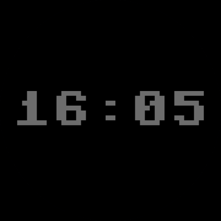

### Welcome to C64 Tribute Watchface

This watchface for Wear OS by Google depicts the legendary colors of the Commodore 64 as well as its iconic font. Based on system settings time is shown in 12 or 24 hour format.

### What it shows

- The time in the C64 screen colors and character set, with the blinking cursor below it
- The date, if you want it, in the order your language uses
- Seconds, if you want them, and uppercase letters, if you prefer them
- White on black in ambient mode, with the cursor at rest
- Round, square and rectangular watches each get their own layout

The three options live where Wear OS keeps watch face settings: press and hold the face, tap Customize, and pick what the face should show.

Get it for free on [Google Play](https://play.google.com/store/apps/details?id=com.thomaskuenneth.c64watchface).

### The phone app

The phone app is a separate install. It shows the face as a preview and holds the same settings along with an About page. It used to carry the watch face inside it, so installing one installed the other. The Android Gradle Plugin dropped that mechanism, and Google Play expects the watch and the phone to ship as separate bundles.

### License

C64 Tribute Watchface is published under the terms of the [GNU General Public License Version 3](./gpl-3.0.txt). It uses the [Pet Me 64](https://www.kreativekorp.com/software/fonts/) font by Rebecca G. Bettencourt, Kreative Software, in accordance with the Kreative Software Relay Fonts Free Use License in [license.txt](./license.txt). The first version of this app, or rather its source code, appeared 2015 in the third edition of my book about Android development called *Android 5*.

### Gradle cheat sheet

- Build every bundle: `./gradlew bundleRelease` (one AAB per module, version codes derived from `baseVersionCode`)
- Update store screenshots for every device class: `./gradlew :screenshots:generateStoreScreenshots` (starts `Pixel_10`, `Pixel_10_Pro_Fold` and `Pixel_Tablet` in turn, so none of them may already be running)
- Update store screenshots on one running emulator only: `ANDROID_SERIAL=<serial> ./gradlew :screenshots:captureStoreScreenshots` (the device class is detected on the device)
- Release to Google Play: the *Upload to Play Internal Testing* workflow, which signs both bundles, uploads the watch face to the Wear OS track and the phone app to its own
